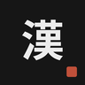
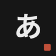
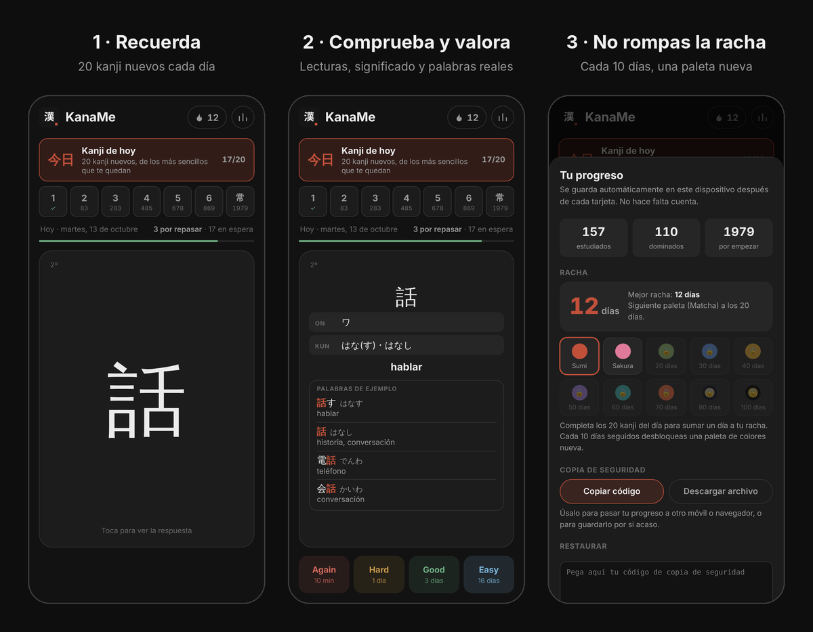
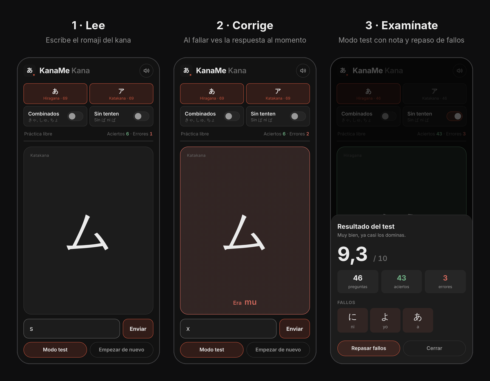

  

  

<h3 align="center">Soy un estudiante de 3º de Ingeniería Informática en la UCM.</h3>

<h3 align="center">Programo principalmente en C++, Java o JavaScript aunque también uso C, Python, SQL o HTML entre otros.</h3>

 

## 🇯🇵 Familia KanaMe

Dos apps para aprender japonés desde cero, pensadas para el móvil.
Sin cuentas, sin anuncios y funcionan sin conexión (PWA).

<table>
  <tr>
    <td width="50%" valign="top">
      
      <b>KanaMe Kanji</b> 
      Los 2136 kanji Jōyō con repetición espaciada
        
      Flashcards con lecturas, significado y 4400+ palabras reales.
      Kanji del día, rachas y paletas de colores que se desbloquean.
        
      
      
    </td>
    <td width="50%" valign="top">
      
      <b>KanaMe Kana</b> 
      Hiragana y katakana en pocos días
        
      Ves un kana, escribes su romaji y sabes al momento si aciertas.
      Modo test con nota sobre 10, repaso de fallos y audio.
        
      
      
    </td>
  </tr>
  <tr>
    <td></td>
    <td></td>
  </tr>
</table>

HTML · CSS · JavaScript puros, sin dependencias · Service Worker · notificaciones push

## 🎮 Don't Kill My Date

<table>
  <tr>
    <td>
      Videojuego web hecho en equipo para Desarrollo de Videojuegos (FDI · UCM).
      Eres una hechicera que prepara pociones a contrarreloj para salvar las citas de sus clientes. 🧪💘
        
      
      
        
      JavaScript · trabajo en equipo · tráiler y arte propio
    </td>
  </tr>
</table>

## 💊 Gestión de farmacia · en producción

<table>
  <tr>
    <td>
      
      
      
        
      Aplicación full-stack terminada y en uso en farmacias para gestionar las fórmulas magistrales:
        
      🧾 Tasación automática según el Concierto farmacéutico de Asturias 
      📦 Control de stock por lotes 
      🖨️ Etiquetas y documentación oficial lista para imprimir
        
      
      
      
      
    </td>
  </tr>
</table>

## 🛠️ Con qué trabajo

  

  

## 📫 Hablemos

  
  
  

